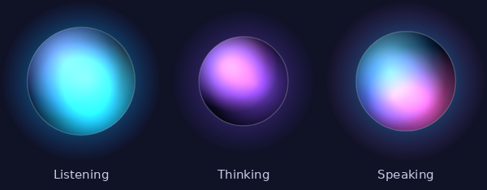
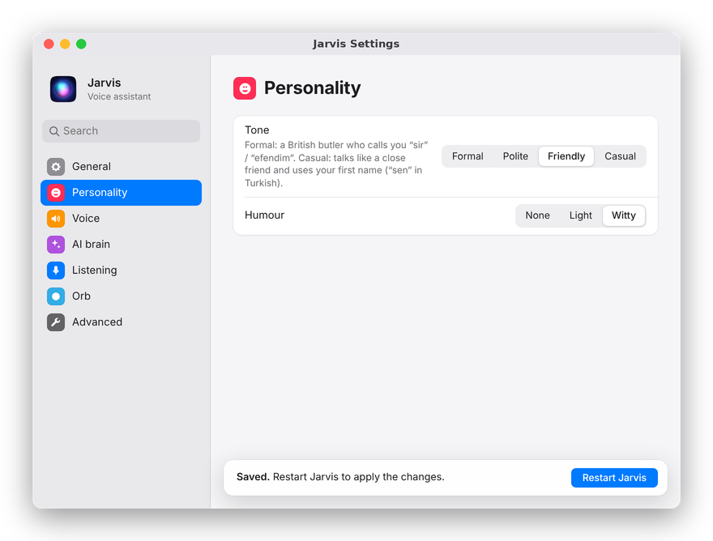
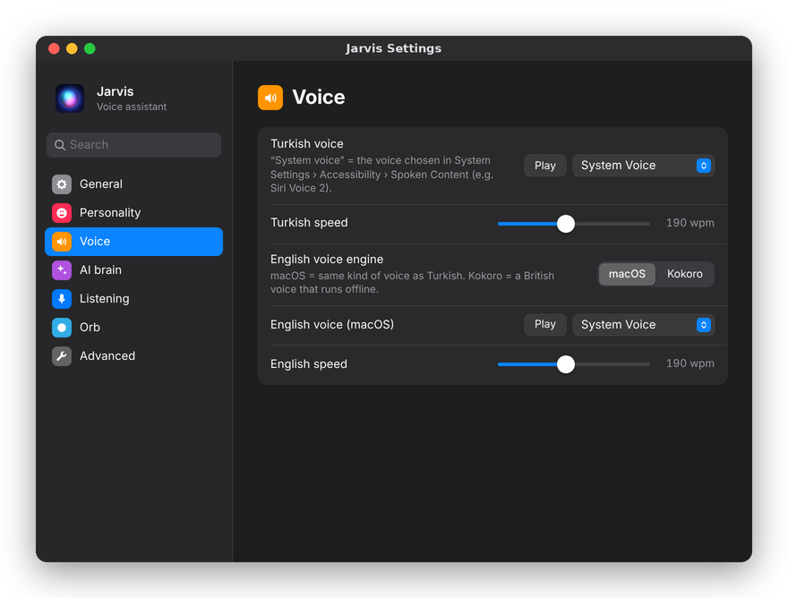
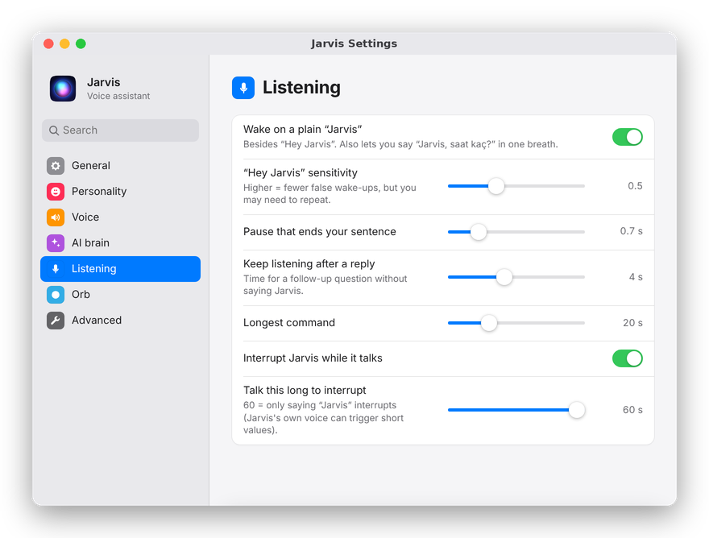
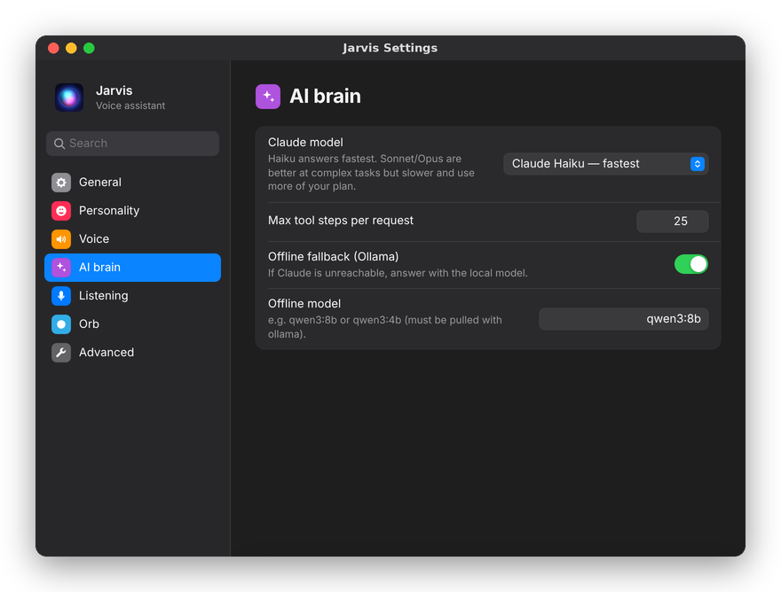

<p align="center">
  
</p>

<h1 align="center">Real Jarvis</h1>

<p align="center">
  <b>A real JARVIS for your Mac.</b><br>
  A bilingual (Turkish / English) voice assistant with a Siri-style animated orb,<br>
  on-device speech, and Claude as its brain.
</p>

<p align="center">
  
</p>

---

Say **“Hey Jarvis”** (or just **“Jarvis”**) and talk to your Mac like Tony Stark does.
Jarvis listens on-device, thinks with Claude, acts on your Mac (apps, files, settings, the web)
and answers out loud in your own language — while a glowing orb in the corner of the screen
shows you what it's doing.

```
You:    Jarvis, masaüstümdeki ekran görüntülerini bir klasöre topla.
Jarvis: Hemen Erkin.  …  Hepsini "Screenshots" klasörüne taşıdım.

You:    Hey Jarvis, what's my battery level?
Jarvis: You're at 95 percent, about seven hours left.
```

## Features

- 🎙️ **Hands-free** — wakes on “Hey Jarvis” *or* a plain “Jarvis”, even in one breath: *“Jarvis, saat kaç?”*
- 🇹🇷🇬🇧 **Bilingual** — detects Turkish or English automatically and replies in the same language
- 🔒 **On-device voice** — wake word, speech-to-text (Whisper on Apple Silicon) and speech all run locally
- 🧠 **Claude brain** — uses the Claude Agent SDK to really *do* things on your Mac, not just chat
- ⚡ **Fast** — instant answers for simple commands (time, volume, opening apps) without any AI call; Claude's
  answers are streamed and spoken sentence by sentence
- ✋ **Interruptible** — say “Jarvis” / “dur” / “stop” (or click the orb) while it talks to cut it off
- 🔮 **Animated orb** — a ChatGPT-voice-style orb in the corner: blue = listening, purple = thinking, pink = speaking
- 🎭 **Adjustable personality** — from a formal British butler (“Yes, sir?”) to a casual friend who uses your first name
- ⚙️ **Apple-style settings** — voice, language, AI model, sensitivity, personality and more, from the menu bar
- 📴 **Offline fallback** — if Claude is unreachable, a local model (Qwen3 via Ollama) takes over
- 🛡️ **Safe by design** — deleting, moving, sending messages and writing outside its workspace need your spoken “yes”;
  `sudo` is always refused; every action is logged

## Screenshots

<p align="center">
  
</p>

<p align="center">
  
  
</p>
<p align="center">
  
  
</p>

## How it works

```
 "Hey Jarvis"  →  openWakeWord ─┐
 "Jarvis, …"   →  Whisper check ┴→ record (Silero VAD) → Whisper large-v3-turbo (MLX)
                                                                    │
                                    instant router (time, volume, apps) ── or ── Claude (Agent SDK, tools on your Mac)
                                                                    │                      └─ offline: Qwen3 / Ollama
                                                                    ▼
                                          macOS voice (e.g. Siri Voice) / Kokoro  →  🔊   +   🔮 orb
```

Everything except the Claude call runs on your Mac.

## Requirements

- A Mac with **Apple Silicon** (M1 or newer), macOS 13+
- [Homebrew](https://brew.sh)
- A **Claude** account (Pro/Max plan or an API key) for the brain
- ~8 GB free disk space for the models

## Install

```zsh
git clone https://github.com/erkinazizi/Real-Jarvis.git ~/Jarvis
cd ~/Jarvis
./install.sh      # Python 3.12, dependencies, local models, Ollama + Qwen3, builds Jarvis.app
./login.sh        # type /login, sign in to Claude in the browser, then /exit
```

Then, in **System Settings → Privacy & Security**, allow **Microphone**, **Accessibility** and **Automation**
for Jarvis (macOS asks the first time).

**Voice (optional but recommended):** in **System Settings → Accessibility → Spoken Content**, pick the voice you like
(e.g. a Siri voice). Jarvis speaks with that “System Voice” by default.

## Use

| | |
|---|---|
| Start | Open **Jarvis** from Launchpad / Spotlight (or `./run.sh` to see logs in Terminal) |
| Talk | “Hey Jarvis” / “Jarvis”, wait for the reply, then speak. Or click the orb. |
| Follow-up | After each answer Jarvis keeps listening a few seconds — no wake word needed |
| Interrupt | While it talks, say “Jarvis”, “dur”, “bekle”, “stop” or “wait” — or click the orb |
| Settings | Menu-bar icon → **Settings…**, or say “open settings” / “ayarları aç” |
| Quit | “Goodbye Jarvis” / “Görüşürüz”, or menu-bar icon → **Quit** |
| Autostart | `./autostart.sh on` (off: `./autostart.sh off`) |

Things to try:

- “Jarvis, open Spotify” · “Spotify'ı aç”
- “What's on my calendar today?”
- “Masaüstümde kaç dosya var?”
- “Turn the volume down” · “Sesi kıs”
- “Create a note called groceries with milk and eggs”

## Settings

All options live in the Settings window and are saved to `settings.json` (defaults are in `config.py`):

| Section | Options |
|---|---|
| General | your name, default language |
| Personality | tone (formal · polite · friendly · casual), humour (none · light · witty) |
| Voice | Turkish / English voice, speed, macOS or Kokoro engine, ▶ preview |
| AI brain | Claude model (Haiku · Sonnet · Opus), max tool steps, offline fallback model |
| Listening | wake on “Jarvis”, wake-word sensitivity, end-of-sentence pause, follow-up time, interrupting |
| Orb | show/hide, corner, size |

## Project layout

| File | What it does |
|---|---|
| `main.py` | main loop, conversation flow, barge-in |
| `audio.py` | microphone, wake word, voice-activity recording |
| `stt.py` | Whisper speech-to-text (MLX) |
| `tts.py` | speech output (macOS voice / Kokoro) |
| `brain.py` | Claude Agent SDK, tools and permission rules |
| `brain_local.py` | offline fallback (Ollama) |
| `router.py` | instant commands without the LLM |
| `persona.py` | personality / tone and fixed phrases |
| `overlay.py`, `ui/orb.html` | the animated orb and the menu-bar icon |
| `settings.py`, `ui/settings.html` | the Settings window |
| `config.py` | default settings |

## Privacy

- Wake word, speech recognition and speech synthesis run **on your Mac**; audio never leaves it.
- The **text** of your request and the results of actions are sent to Claude (Anthropic) to decide what to do.
  With the offline fallback, nothing leaves your Mac.
- `settings.json`, `logs/` (action log, last recording) and downloaded models are git-ignored.

## Limitations

- macOS on Apple Silicon only (MLX speech recognition, AppleScript automation).
- Turkish and English only.
- Each Claude request counts toward your Claude plan's usage.

## Credits

Built with [Claude Agent SDK](https://docs.claude.com), [mlx-whisper](https://github.com/ml-explore/mlx-examples),
[openWakeWord](https://github.com/dscripka/openWakeWord), [Silero VAD](https://github.com/snakers4/silero-vad),
[Kokoro](https://huggingface.co/hexgrad/Kokoro-82M), [Piper](https://github.com/rhasspy/piper),
[pywebview](https://pywebview.flowrl.com) and [Ollama](https://ollama.com).

*JARVIS is a character from the Iron Man films. This is an independent fan project, not affiliated with Marvel or Disney.*

## License

[MIT](LICENSE) © 2026 Erkin Azizi
